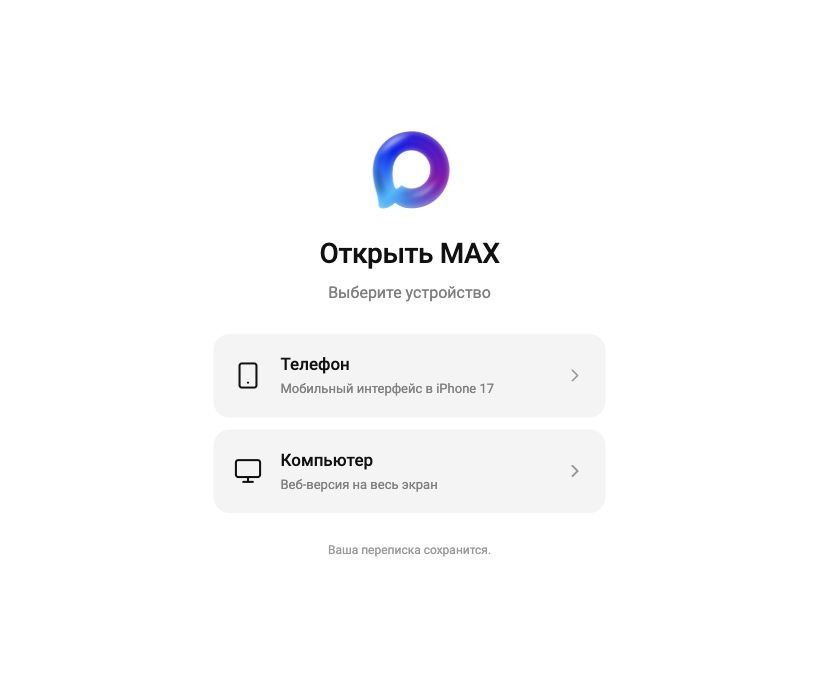
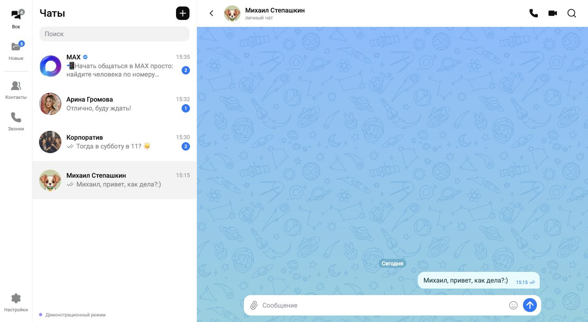
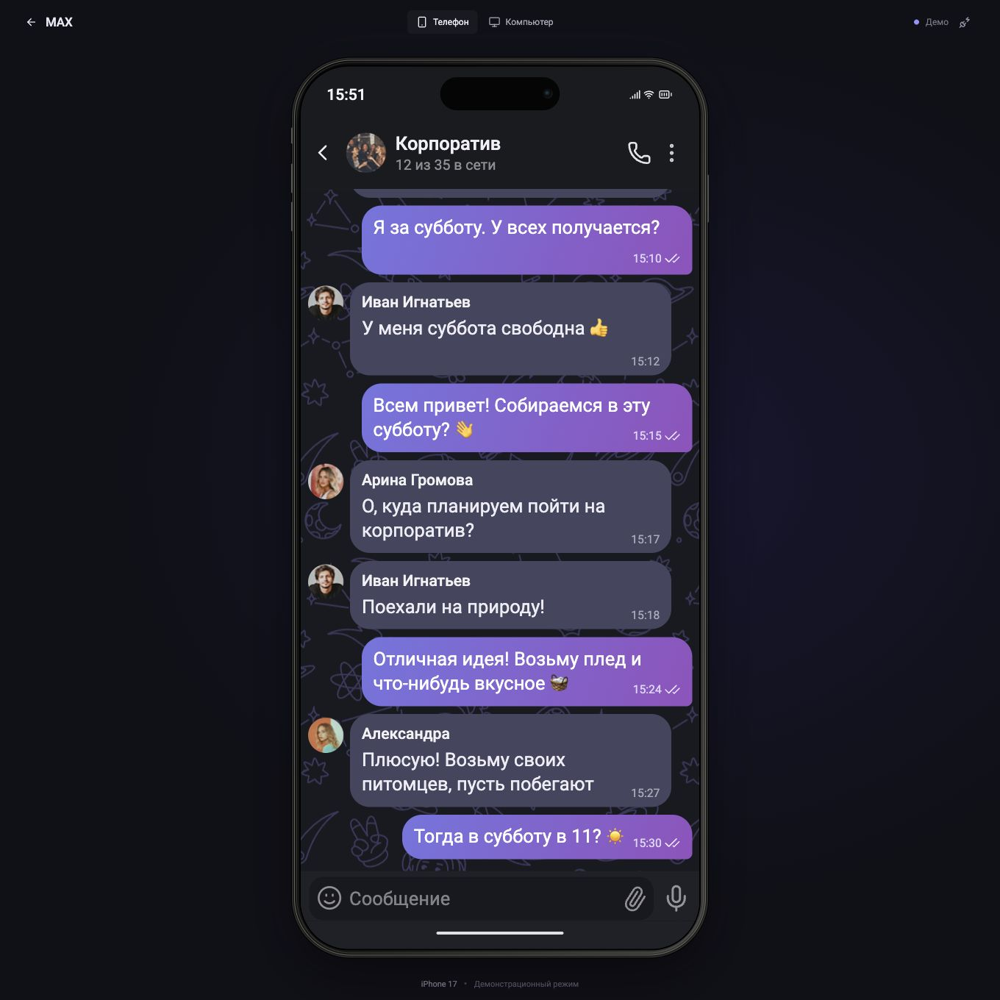
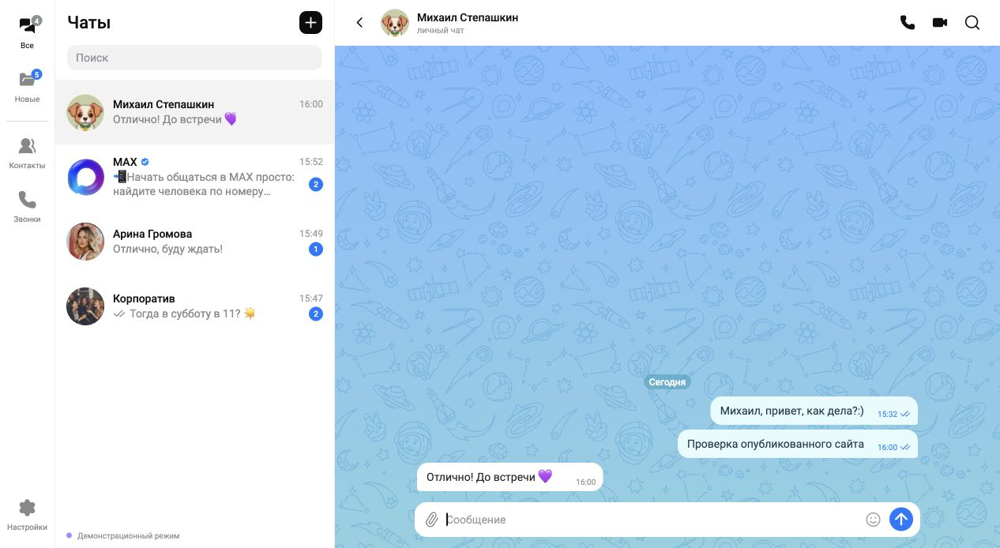
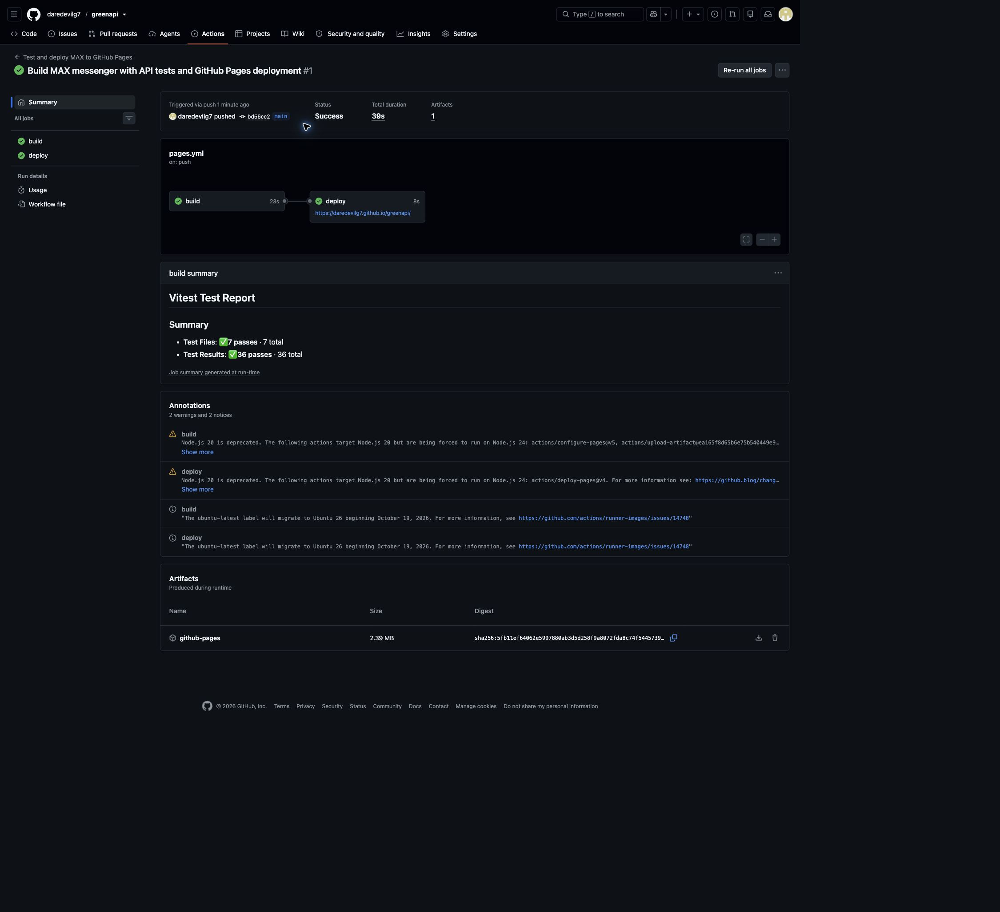

# MAX · GREEN-API

React-приложение для отправки и получения **текстовых сообщений MAX** через GREEN-API. Сначала пользователь выбирает устройство: тёмный мобильный интерфейс внутри интерактивного макета iPhone 17 или светлый десктопный MAX на весь экран.

**Сайт:** [daredevilg7.github.io/greenapi](https://daredevilg7.github.io/greenapi/). **Репозиторий:** [daredevilg7/greenapi](https://github.com/daredevilg7/greenapi).

## Скриншоты проверенного интерфейса

Снимки сделаны при проверке приложения в браузере. В демонстрационном режиме сообщения и ответы создаются локально. Реальные API-ключи и личная переписка на скриншоты не попадают.

### Выбор устройства



### Компьютер — веб-интерфейс MAX



### Телефон — переписка в iPhone 17



### Проверка опубликованного сайта

Веб-версия открыта с GitHub Pages; отправка и ответ проверены в демонстрационном режиме.



### Автоматические тесты и публикация

Все 36 тестов и оба задания `build` / `deploy` успешно выполнены в [GitHub Actions](https://github.com/daredevilg7/greenapi/actions/runs/37197122328).



Подробные сценарии, результаты 36 автоматических тестов и ограничения реального API-прогона: [отчёт о проверках](docs/verification.md).

## Быстрый запуск

Нужны Node.js 22.20+ и npm. Проект проверен с Node.js 22.20.0.

```bash
git clone https://github.com/daredevilg7/greenapi.git
cd greenapi
npm ci
npm run dev
```

Открыть [http://127.0.0.1:5173](http://127.0.0.1:5173).

Чтобы оценить оформление без ключей, выберите устройство и нажмите **«Попробовать без подключения»**. В этом режиме переписка и ответы моделируются локально; сообщения не отправляются в MAX.

## Подключение к MAX

1. Создайте **MAX-инстанс** в [кабинете GREEN-API](https://console.green-api.com/) и авторизуйте свой аккаунт MAX. Инстанс WhatsApp для этого проекта не подходит.
2. В настройках инстанса включите получение входящих сообщений: `incomingWebhook: "yes"`.
3. Поле `webhookUrl` должно быть пустым, чтобы уведомления читались через HTTP API.
4. Для отображения статусов отправки включите `outgoingWebhook: "yes"`. Для сообщений, отправленных с телефона, — `outgoingMessageWebhook: "yes"`; для исходящих из API — `outgoingAPIMessageWebhook: "yes"`.
5. В приложении введите `idInstance` и `apiTokenInstance`. Если необходимо, раскройте **«Адрес API»** и вставьте `apiUrl` из кабинета. По умолчанию адрес определяется по первым четырём цифрам `idInstance`.
6. Нажмите **«Подключиться»**, затем **«Новый чат»**. Введите номер получателя РФ или Беларуси. Имя контакта необязательно.
7. Напишите текст и отправьте кнопкой или Enter. Shift + Enter добавляет новую строку. Ответ получателя автоматически появится в чате.

При проверке номера используется `checkAccount`: приложение получает настоящий MAX `chatId`, а не предполагает, что он совпадает с номером телефона. Поиск по номеру зависит от настроек приватности MAX получателя.

## Что реализовано

- React + TypeScript, два интерфейса и общая модель переписки.
- Выбор устройства до подключения и переключение с сохранением сообщений и черновиков.
- Ввод и проверка ключей, проверка состояния и настроек инстанса.
- Новый чат по номеру, локальное имя, поиск по чатам и переписке, непрочитанные сообщения.
- Отправка текста до 4000 символов, многострочный ввод и эмодзи.
- Последовательный long polling: получение → обработка → подтверждение. Повтор квитанции не создаёт дубликат сообщения.
- Состояния отправки, доставки, прочтения и ошибки. Подтверждение `sendMessage` означает принятие в очередь, а не доставку.
- Восстановление получения после сетевой ошибки. Отмена запросов при выходе и защита от ответов предыдущей сессии.
- Ручной повтор неуспешной отправки. При неоднозначной сетевой ошибке повтор требует проверки, чтобы не отправить текст дважды.
- Демо без внешних запросов; адаптивность; доступные диалоги с Escape и удержанием фокуса; поддержка уменьшения анимации.

Задание ограничено текстом: звонки, аудио, файлы, стикеры и реакции не реализованы. Значки звонков в шапке сохранены для соответствия референсу и отключены с объяснением.

## Сборка и проверки

```bash
npm test
npm run test:api
npm run build
npm run preview
```

Производственная сборка находится в `dist/`. Для сервера достаточно статического хостинга: Nginx, Apache или аналог. Node.js требуется для сборки, а не для работы опубликованного сайта. Все ресурсы интерфейса включены локально. При публикации используйте HTTPS.

## GitHub Pages

Публикация настроена в [.github/workflows/pages.yml](.github/workflows/pages.yml): при изменении `main` GitHub Actions устанавливает зависимости, запускает все 36 тестов, собирает приложение для `/greenapi/` и публикует только каталог `dist/`. Реальные API-тесты и ключи в CI не используются. Неуспешные тесты или сборка останавливают публикацию.

В настройках репозитория **Settings → Pages → Source** выбран **GitHub Actions**. Проверить ту же сборку локально:

```bash
npm run build:pages
npm run preview:pages
```

Открыть [http://127.0.0.1:4173/greenapi/](http://127.0.0.1:4173/greenapi/). Для другого статического хостинга в корне домена используйте обычную команду `npm run build`.

## API-тесты

`npm run test:api` проверяет клиент через настоящий локальный HTTP-сервер. Это независимый от внешнего сервиса прогон запросов, ответов, подтверждения квитанций и отмены long polling. Подмена глобального `fetch` здесь не используется. Все 36 обычных тестов можно запустить одной командой `npm test`.

Для реального GREEN-API есть отдельный прогон. Скопируйте `.env.live.example` в `.env.live` и заполните ключи, `apiUrl` и номер получателя. Имена переменных не начинаются с `VITE_`, файл исключён из репозитория. По умолчанию режим `read` проверяет только состояние и настройки инстанса:

```bash
npm run test:api:live
```

Для одной отправки установите `GREEN_API_TEST_MODE=send`; для отправки и ожидания ответа — `roundtrip`. Тест просит получателя ответить **«Тест пройден»** и ожидает ответ до двух минут. После отправки создаётся маркер `.local/api-send-marker.json`, поэтому следующий прогон не отправляет сообщение автоматически ещё раз. Проверить позже поступивший ответ можно без повторной отправки:

```bash
npm run test:api:receive
```

Во время реального теста отключите подключённую вкладку приложения, чтобы два получателя не конкурировали за одну очередь. Отчёт находится в `.local/api-live-report.json`: токен и текст личной переписки не записываются. Неоднозначная сетевая ошибка при отправке также оставляет маркер; перед его ручным удалением проверьте чат MAX.

**Реальная доставка пока не подтверждена.** Прогон с предоставленным инстансом был выполнен, но соединение с GREEN-API прервалось до HTTP-ответа. На предоставленном скриншоте инстанс также был не авторизован. Проверенный набор сценариев и текущий результат описаны в [docs/verification.md](docs/verification.md).

## Структура

```text
src/chat/        HTTP-клиент, очередь уведомлений, модель и сессия
src/components/ Экран выбора, подключение, оболочки и элементы чата
src/App.tsx     Сценарий приложения, выбор устройства и диалоги
src/styles.css  Оформление и адаптивность
public/assets/  Локальные ресурсы MAX
docs/           Дизайн, план, источники ресурсов, проверка
```

## Данные сессии

В интерфейсе ключи и переписка хранятся в памяти приложения, не записываются в localStorage, sessionStorage, cookies или код. Выход и перезагрузка страницы очищают сессию. Запросы идут напрямую из браузера в GREEN-API; по протоколу GREEN-API токен передаётся в URL запроса. Не включайте реальные ключи в репозиторий, скриншоты сетевой панели и отчёты.

История предыдущих сессий не загружается. Приложение читает очередь уведомлений активного инстанса; одновременно запускать несколько получателей одной очереди не следует, поскольку они конкурируют за события.

## Документация и референсы

- [GREEN-API MAX: SendMessage](https://green-api.com/v3/docs/api/sending/SendMessage/)
- [Получение сообщений через HTTP API](https://green-api.com/v3/docs/api/receiving/technology-http-api/)
- [CheckAccount](https://green-api.com/v3/docs/api/service/CheckAccount/)
- [MAX Web](https://web.max.ru/)
- [Источники визуальных ресурсов](docs/asset-sources.md)

Проект подготовлен как самостоятельное тестовое задание. Сайт работает на GitHub Pages; инструкция для локального запуска, скриншоты и отчёт о проверках находятся в этом репозитории.
